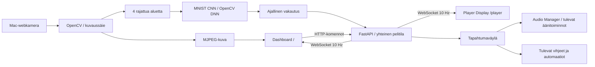

# Escape Room Control System — Version 1

## Päätökset

React, TypeScript ja Vite tuottavat staattisen käyttöliittymän. FastAPI palvelee buildin, HTTP-komennot, MJPEG-kamerakuvan ja WebSocketin samalla portilla. Yksi paikallinen Python-prosessi omistaa kaiken pelitilan ja kameran. Tuotantokäyttöön ei tarvita Node-prosessia, pilveä, tietokantaa, CDN:ää eikä ulkoisia fonttipalveluita. Asennuksen riippuvuuksien lataaminen tarvitsee internetin; käyttö toimii offline.

Ajastin käyttää `time.monotonic()`-kelloa: järjestelmäkellon siirto ei muuta peliaikaa. Backend päivittää tilan 100 ms välein; selaimet näyttävät viimeisimmän tilan, eivät hallitse omia ajastimia. Ajan päättyminen tarkistetaan ennen numerohavainnon soveltamista. Ratkaisu ja ajan loppuminen jäävät voimaan nollaukseen asti. Ajastin pysähtyy ratkaisuun. Pause säilyttää havainnot. Nollaus palauttaa peliajan, tyhjentää havainnot ja aloittaa vakautuksen alusta. Koodin tai keston muuttaminen vaatii pysäytetyn pelin; keston muutos nollaa pelin.

WebSocket on vain lukua varten. Komennot lähetetään validoituina HTTP-pyyntöinä. Tämä tekee virheiden näyttämisestä ja API:n testauksesta suoraviivaista. Pelaajien `role=player`-tilannekuva ei sisällä oikeaa koodia, kameratietoja tai tapahtumalokia. Rooleja ei ole todennettu: kyseessä on luotetun paikallisverkon demo. Ohjauspaneeli ja API ovat kaikkien samassa verkossa olevien saavutettavissa. Ennen käyttöä julkisessa tai osallistujille avoimessa verkossa lisää ohjaajan tunnistus, erilliset verkot ja HTTPS. V1 ei ole fyysisen poistumisoven tai turvallisuuslaitteen ohjain.

## Tietovirta



## Rakenne

```text
backend/
  main.py          HTTP, WebSocket, taustasilmukat, asetusten tallennus
  state.py         Pelin tilakone ja ajastin
  models.py        Pydantic-validointi ja oletusalueet
  camera.py        Kameran omistus, kuvaussäie ja JPEG-puskuri
  recognition.py   Kuvan esikäsittely, muotovertailu, OCR ja vakautus
  events.py        Tapahtumaväylä ja viimeisten 60 tapahtuman historia
  audio.py         Erillinen Audio Manager -laajennuspiste
  assets/          Paikalliset numeromallien fontit ja lisenssi
frontend/src/
  Dashboard.tsx    Ohjauspaneeli ja pelin asetukset
  CameraPanel.tsx  Live-kuva ja rajausalueiden säätö
  Player.tsx       Pelaajien näyttö ja onnistumisanimaatio
  useRoom.ts       WebSocket, uudelleenyhdistäminen ja komennot
  types.ts         Tilatyypit ja ajastimen esitys
  styles.css       Responsiivinen visuaalinen järjestelmä
printables/        Paikallinen, tulostettava numerolappusarja 0–9
scripts/           Asennus, käynnistys ja kehityskäyttö
runtime/config.json Paikallisesti tallennetut asetukset; ei versionhallintaan
```

## Kameratunnistus

Kamera sijaitsee palvelinta ajavalla Macilla. macOS käyttää OpenCV:n AVFoundation-ajuria. Kameran avaaminen tapahtuu käyttäjän painikkeesta. Pelaajien laite vastaanottaa vain pelitilan; sen selain ei tarvitse kamerakäyttöoikeutta eikä getUserMedia/HTTPS-yhteyttä.

Kuvaus on erillisessä säikeessä. Neljä aluetta tunnistetaan rinnakkain `asyncio.to_thread`-töinä, ja kierrosten välissä odotetaan 50 ms. ONNX Model Zoon valmiiksi koulutettu MNIST-12 CNN suoritetaan OpenCV DNN:llä paikallisesti CPU:lla. Jokaisella työntekijäsäikeellä on oma verkkoinstanssi. Malli on projektissa ja sen SHA-256 tarkistetaan; käynnistys ei lataa tiedostoja verkosta. Tesseract-aliprosesseja ei enää käytetä.

Jokaisen alueen käsittely:

1. Harmaasävy, kontrastin normalisointi, Otsu-kynnystys ja taustan polariteetin valinta. Tasaiset alueet hylätään.
2. Yhdistetyt komponentit paikantavat numeron. Taustan laajat reunat ohitetaan ja useat erilliset merkit hylätään. Leikkautuminen ja risteävät viivat merkitään hylkäyssyyksi; niiden mallipisteet voidaan silti näyttää.
3. Numeron harmaasävyrajaus sovitetaan 20×20-alueeseen, keskitetään massakeskipisteen mukaan 28×28-kuvaan ja skaalataan välille 0–1 (vaalea numero mustalla taustalla).
4. CNN:n kymmenestä logitista saadaan softmax-pisteet. Raja on 15/100 ja kahden parhaan ehdokkaan eron on oltava vähintään 5 pistettä. Ohjaajalle lähetetään mallin nimi, raakapisteet, kolme ehdokasta, syötekuva ja hylkäyssyy. Vanhat `ocr_*`-kenttänimet säilyvät API-yhteensopivuuden vuoksi; pelaajille diagnostiikkaa ei lähetetä.
5. Vähintään kolme peräkkäistä samaa havaintoa ja vähintään 0,65 sekunnin vakaus. Ristiriitainen numero poistaa vanhan numeron heti; tyhjä tai epävarma signaali poistaa sen 0,55 sekunnissa. Yli 1,5 sekunnin näytekatko aloittaa vakautuksen uudelleen.

Ratkaisun hyväksyminen kameratilassa vaatii lisäksi, että saman tuoreen kuvan kaikki neljä havaintoa ovat varmoja ja vastaavat vakautettuja numeroita. Lyhyt epävarman signaalin merkkivalon viive ei voi yksin käynnistää voittoa.

Yli kaksi sekuntia vanhaa kamerakuvaa ei käytetä. Kameran sulkeminen tai vika tyhjentää aktiiviset kamerahavainnot. Käynnissä olevan tunnistustyön tulos pudotetaan, jos sen aikana tapahtui nollaus, tilanvaihto tai alueiden muutos. Ratkaistu tila säilytetään nollaukseen asti.

Tunnistuksen tulos ei koskaan riipu oikeasta koodista. Malli on tarkoitettu yksittäisille käsinkirjoitetuille numeroille. MNIST-testiaineiston tulosta ei pidä tulkita kameratarkkuudeksi: suuri perspektiivivääristymä, heijastukset ja sekava tausta voivat edelleen rikkoa tunnistuksen. MNIST-mallilla ei ole opittua erillistä ei-numeroa-luokkaa; esikäsittely ja vakautus eivät poista kaikkia vääriä havaintoja.

## Tapahtumat ja laajennukset

Tapahtumissa on järjestysnumero, UTC-aikaleima, tyyppi ja payload. V1 julkaisee:

| Tapahtuma | Merkitys |
| --- | --- |
| `system.ready` | Palvelin valmis |
| `timer.started`, `timer.paused` | Ajastimen ohjaus |
| `timer.warning` | 5 minuutin raja alittuu kerran pelissä |
| `timer.expired` | Aika loppui |
| `digits.changed` | Havaitut numerot ja oikeat paikat muuttuvat |
| `game.solved`, `game.reset`, `game.simulated` | Pelin päätös, nollaus ja testaus |
| `mode.changed`, `config.changed`, `camera.status` | Ohjaus- ja kameramuutokset |

`AudioManager` tilaa tapahtumaväylän ja valitsee tulevan äänitoiminnon tunnisteen. V1 ei lataa tai soita musiikkia. Vihje- ja automaatiomoduulit voivat myöhemmin tilata saman väylän. Hidas toiminto tulee välittää työjonoon; tapahtumankäsittelijä ei saa estää ajastinta. Kuuntelijan poikkeus ei pysäytä muita kuuntelijoita.

Vihjeiden lisääminen tarkoittaisi uutta validoitua komentoa, ajallisesti rajattua viestiä pelitilaan ja Player-komponenttia. Vaiheisiin reagoiva musiikki voi tilata uuden `stage.changed`-tapahtuman. Näitä ei ole toteutettu V1:een. Tapahtumahistoria ja pelitila ovat muistissa, asetukset levyllä. Tila ja yhteydet eivät jakaudu usealle työntekijälle, joten käytä aina `--workers 1`.

## Rajauksen koordinaatit ja tallennus

Näkyvät kehykset ja kamerakuva käyttävät samaa reunuksetonta, kuvasuhteen säilyttävää pintaa. Pointer-koordinaatit normalisoidaan tämän pinnan mittoihin. Valittu kehys nostetaan muiden päälle, jotta päällekkäinen alue ei peitä koonmuutoskahvaa.

Kehyksen siirto/koonmuutos tallentuu 350 ms vapauttamisen jälkeen; prosenttikentät saman viiveen jälkeen. Keskeneräisen tai epäonnistuneen tallennuksen tila näkyy käyttäjälle. Tallennuspyynnöt sarjoitetaan ja niiden aikana tehdyt uudet muutokset tallentuvat seuraavassa pyynnössä. HTTP-komennon palauttama tilanne otetaan heti käyttöön, eikä vanhempi WebSocket-tilanne saa korvata uudempaa aikaleimaa.

Backend muuntaa normalisoidut koordinaatit alkuperäiseen kamerakuvaan `region_bounds`-funktiolla: vasen/ylä pyöristetään alaspäin, oikea/ala ylöspäin ja rajat pidetään kuvan sisällä. Ohjaajan diagnostiikkaan lisätty `roi_image` näyttää juuri tästä leikkauksesta pienennetyn JPEG-esikatselun ennen numeron irrotusta. `input_image` näyttää erikseen CNN:n 28×28-syötteen.
